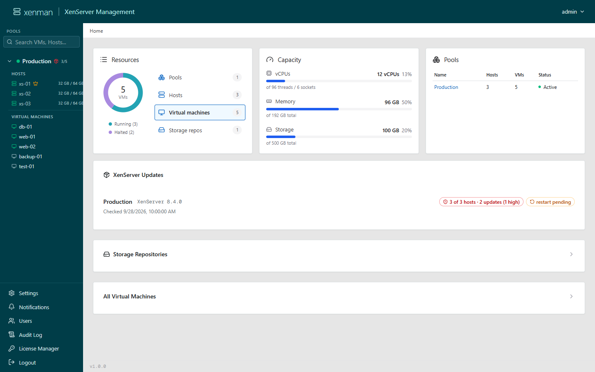
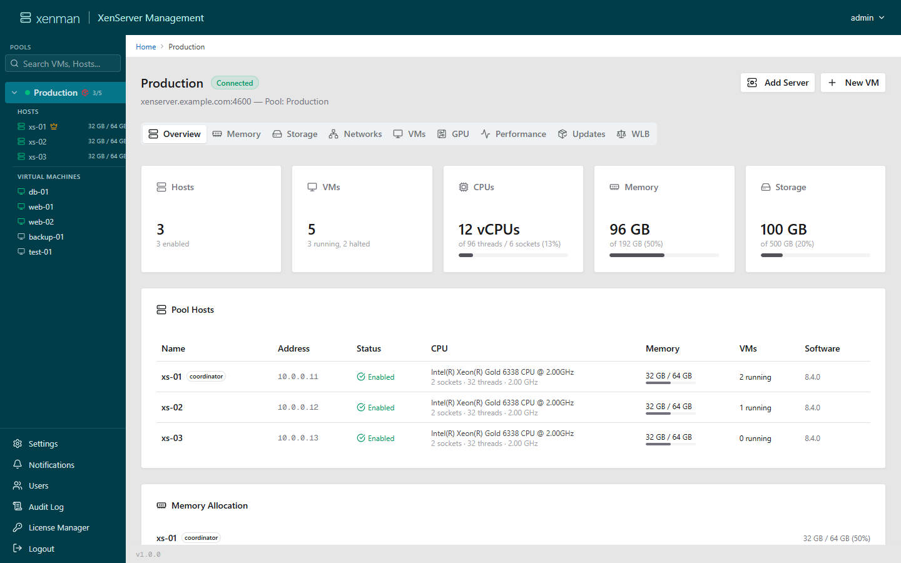
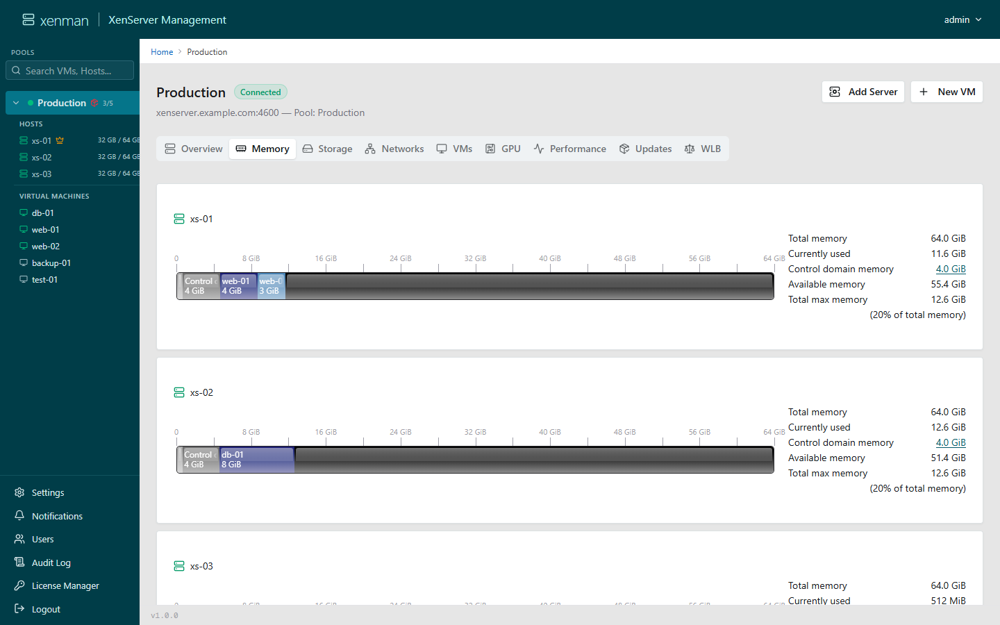
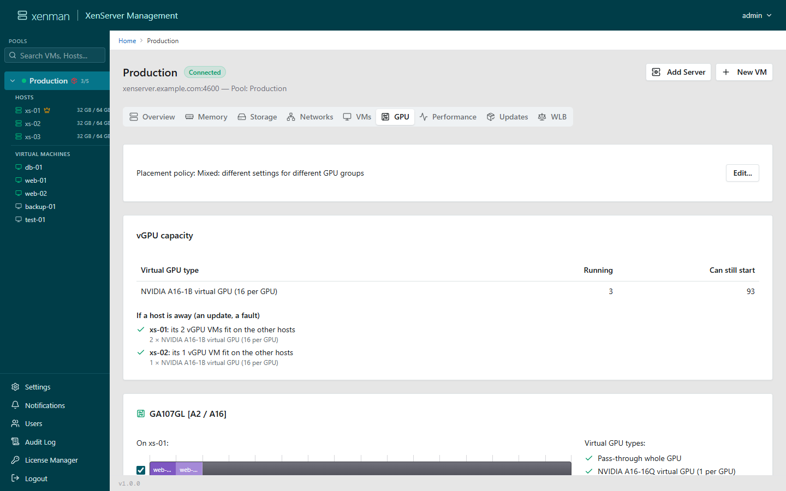
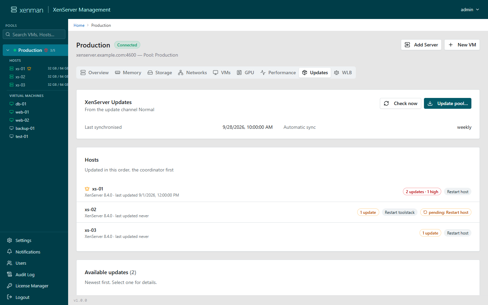
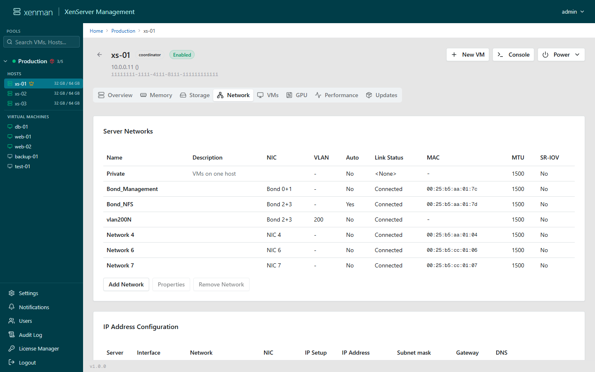
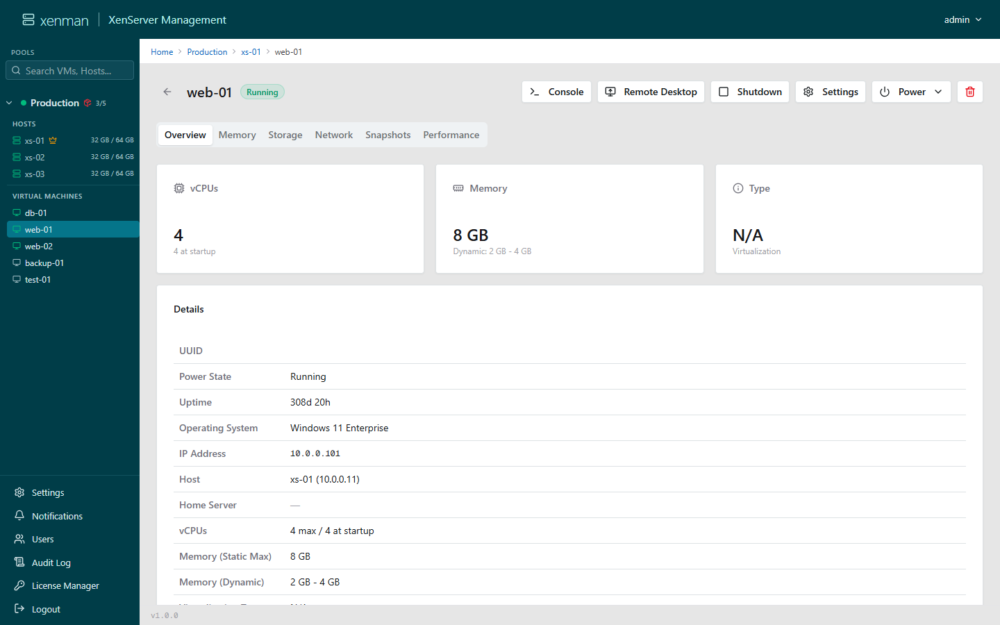
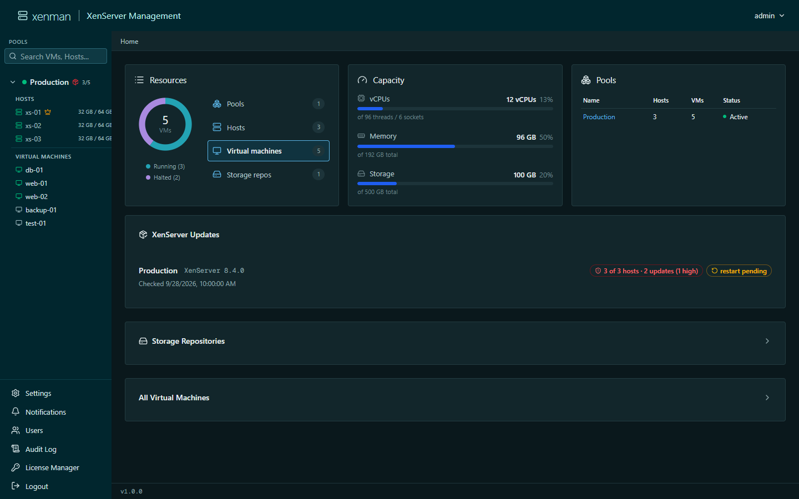

# XenMan

A modern web-based management interface for XenServer / XCP-ng hosts and virtual machines. Built with Next.js, it provides real-time monitoring, VM lifecycle management, and browser-based VNC console access.



## Features

Many workflows follow XenCenter's, with its checks and texts, so XenMan feels familiar.

- **Pools & hosts** — several pools at once, maintenance mode, add and remove servers, control domain memory, certificate pinning
- **VMs** — create, import (XVA), start/stop, migrate, copy (fast clone or full copy), delete; templates from VMs and snapshots; edit CPU, memory, disks, network and boot settings
- **Console** — VNC in the browser with keyboard macros and clipboard paste; RDP file download
- **Memory, storage, networking** — XenCenter-style Memory tab with dynamic memory editing; SRs (create, repair, detach, forget, destroy) and disks; networks, bonds, VLANs and the management interface
- **GPU** — physical GPUs and vGPUs, placement policy and allowed vGPU types, vGPUs assigned to VMs
- **Updates & licensing** — host updates with mail notification, License Manager, Workload Balancing
- **Monitoring** — performance graphs, alerts, events and an audit log
- **Users** — Admin / Operator / Viewer roles, invitations and password reset by mail, inactivity sign-out
- **Settings** — SMTP, syslog, time and date format, TLS certificate; light and dark theme


## Is it production-ready?
Yes, the core functionality of XenMan has been actively running and tested in a real production environment for over 8 months now. While we continuously push new features, the foundation is stable.
However, please note that XenMan focuses on everyday pool and VM administration. Specialized enterprise tasks like HA configuration, OVF imports, cross-pool storage migration, vApps, snapshot schedules, disaster recovery, Active Directory integration, Server Status Reports, or Rolling Pool Upgrades are not yet included. For these specific edge cases, you should keep the standard XenCenter client at hand.

## Screenshots

<table>
  <tr>
    <td width="50%"><a href="docs/screenshots/pool.png"></a><br>Pool overview</td>
    <td width="50%"><a href="docs/screenshots/pool-memory.png"></a><br>Memory, as in XenCenter</td>
  </tr>
  <tr>
    <td width="50%"><a href="docs/screenshots/pool-gpu.png"></a><br>GPUs and vGPU capacity</td>
    <td width="50%"><a href="docs/screenshots/pool-updates.png"></a><br>XenServer updates</td>
  </tr>
  <tr>
    <td width="50%"><a href="docs/screenshots/host-network.png"></a><br>Host networking</td>
    <td width="50%"><a href="docs/screenshots/vm.png"></a><br>A virtual machine</td>
  </tr>
  <tr>
    <td width="50%"><a href="docs/screenshots/dark-dashboard.png"></a><br>Dark theme</td>
    <td width="50%"></td>
  </tr>
</table>

## Tech Stack

- **Framework**: Next.js 16 (React 19, TypeScript)
- **UI**: Radix UI, Tailwind CSS 4, shadcn/ui, lucide-react
- **Auth**: JWT (httpOnly cookies, bcrypt password hashing)
- **XenAPI**: JSON-RPC over HTTPS
- **Console**: noVNC (WebSocket proxy)
- **Email**: Nodemailer (SMTP)

## Built with AI

XenMan is developed with an AI coding assistant: much of the code, the tests and this documentation were written by AI, directed by its maintainers and tested on real XenServer pools. Where XenMan behaves like XenCenter, that behaviour is taken from XenAdmin's published source rather than guessed. As with any tool that manages production infrastructure, try it on a test pool first.

## Getting Started

### Prerequisites

- Node.js 24+
- A XenServer or XCP-ng host

### Development

```bash
npm install
npm run dev
```

Open [http://localhost:3000](http://localhost:3000). Default credentials: `admin` / `admin`.

### Environment

Create a `.env.local` file (optional):

```env
DATA_DIR=./data
```

Host configurations, passwords, and JWT secrets are stored in the `data/` directory.

## Deployment

### Docker

```bash
docker compose up -d
```

Runs the published image `ghcr.io/xenman-project/xenman` (`:latest`, or a release such as `:v1.0.1`). Open `https://<host>:3001`; port `3000` only redirects there. Data persists in a `xen-data` volume.

To build the image from this repository instead: `docker build -t ghcr.io/xenman-project/xenman:latest .`

### Appliance

XenMan also comes as a ready-to-import XenServer VM: Debian 13 with XenMan running under systemd, delivered as a single `.xva` file. It is built from this repository on any Debian or Ubuntu machine — no XenServer host needed:

```bash
sudo ./appliance/build-appliance.sh      # → dist/xenman-appliance-<tag>.xva
```

Import it with `xe vm-import filename=xenman-appliance-<tag>.xva` or in XenCenter under *File → Import*, then start the VM. The console shows the address it got by DHCP.

| | |
|---|---|
| Web | `https://<address>/` — login `admin` / `admin`, a new password is required first |
| Console | `root` / `xenman` — a password change is forced at first login; then a menu for network, SSH, restarts and resetting an administrator's password |
| Network | DHCP or static, set under Settings → Appliance → Network (applied on probation, so a typo cannot lock you out) |
| Data | `/var/lib/xenman` |

Updates come in three kinds:

- **XenMan** — by hand: a signed `.xenup` package from the [releases](https://github.com/xenman-project/xenman/releases), uploaded under Settings → Appliance. The appliance checks the signature against the release key it was built with.
- **Debian security updates** — installed by `unattended-upgrades` in a maintenance window you set.
- **Debian or Node.js major versions** — a new appliance; the data directory is copied across.

Building, signing keys, proxies and the `.xva` format are described in [appliance/README.md](appliance/README.md).

### Manual

```bash
npm run build
npm start
```

## HTTPS

XenMan automatically generates a self-signed TLS certificate on first startup and serves HTTPS on port `3001`. On Linux/Docker it uses `openssl`, on Windows it uses PowerShell.

Plain HTTP is redirected to HTTPS, and HTTPS responses carry HSTS. Only requests from the machine itself stay on HTTP. If a port mapping puts HTTPS on another port than `HTTPS_PORT`, set `XENMAN_PUBLIC_HTTPS_PORT` to the one browsers reach.

XenMan's pages may not be shown in a frame on another site (`X-Frame-Options: DENY`, `frame-ancestors 'none'`), and each server takes at most 1000 open connections; `XENMAN_MAX_CONNECTIONS` changes that, `0` lifts it.

To disable HTTPS, set the environment variable `HTTPS_PORT=0` — only behind a proxy that speaks HTTPS to the browsers (see below).

### Custom Certificate

To use your own certificate, place either PEM files (`cert.pem` + `key.pem`) or a PFX file (`cert.pfx`) in the data directory before starting XenMan.

You can generate a self-signed certificate manually:

**Linux / macOS (openssl):**

```bash
openssl req -x509 -newkey rsa:2048 -keyout data/key.pem -out data/cert.pem -days 3650 -nodes -subj "/CN=XenMan"
```

**Windows (PowerShell, run from XenMan install directory):**

```powershell
$cert = New-SelfSignedCertificate -Subject "CN=XenMan" -CertStoreLocation "Cert:\CurrentUser\My" -NotAfter (Get-Date).AddYears(10) -KeyExportPolicy Exportable
$pfxBytes = $cert.Export([System.Security.Cryptography.X509Certificates.X509ContentType]::Pfx, "xenman")
[IO.File]::WriteAllBytes("$PSScriptRoot\data\cert.pfx", $pfxBytes)
Remove-Item "Cert:\CurrentUser\My\$($cert.Thumbprint)" -ErrorAction SilentlyContinue
```

## XenServer host certificates

XenServer hosts present self-signed certificates, so XenMan checks them the way SSH checks host keys:

- **Adding a pool** shows the SHA-256 fingerprint of the coordinator's certificate. Compare it with the host before trusting it:
  `openssl x509 -noout -fingerprint -sha256 -in /etc/xensource/xapi-ssl.pem`
- **The other hosts of the pool** are learned from the pool itself over that checked connection, including renewed certificates (audited).
- **Every connection** to a host — XAPI, performance data, updates, consoles — is made only if the host presents one of the pool's trusted certificates; otherwise nothing is sent to it, the attempt is audited, the admins are mailed (at most once a day per pool) and a warning shows in XenMan, where an admin can accept a deliberately renewed certificate.
- **SSH host keys** for the export over SSH are remembered on first use; a different key later is refused the same way.
- Pools configured before this check existed are taken over on their first connection and flagged for an admin to compare once.

The trusted certificates per pool are listed under **Settings > Pools > Host certificates** and stored in `host-trust.json` in the data directory.

## Stored passwords

The XenServer and mail server passwords are stored AES-256-GCM encrypted in `hosts.json` and `smtp.json` (readable by XenMan only). The key is not the login secret:

- **On the appliance** it lives outside the data directory, in `/etc/xenman/secret-key.cred`, encrypted by `systemd-creds` with the machine's own key (and its TPM, if it has one). It is decrypted into memory at boot for XenMan only (`xenman-credential.service`). A copy or backup of the data directory alone cannot be decrypted; restored onto another appliance, the pools are marked *password unreadable* and their passwords have to be entered again.
- **Elsewhere** (Docker, Windows) it is a key of its own in the data directory, `.secret-key`.

Passwords stored by earlier versions are re-encrypted with the current key on the next start.

## Pools at other sites (hosts behind NAT)

XenMan can manage a pool it reaches only through NAT, such as a firewall's virtual IP in front of a pool at another site. Add the pool with the address its coordinator is reached at. Everything then works except what XenServer hands out at a host's own management address: consoles, performance graphs, imports and SSH exports. XenCenter has the same limit.

To make those work too, edit the pool under **Settings → Pools** and switch on **Hosts are behind NAT**. XenMan lists the pool's hosts with the address each one reports; enter the address it is reached at from XenMan (the coordinator's is filled in). Each host needs an address of its own, with ports 443 and, for SSH exports, 22 passed through. The firewall must pass TLS through unchanged: every host's certificate is checked against the pool's as before.

Off, which is the default, nothing changes.

## Consoles behind a reverse proxy (NetScaler)

noVNC asks for the next picture only when the last one has arrived, so on a long round trip the console gets few pictures per second. XenMan sits next to the hosts and asks ahead on the browser's behalf (every 33 ms; `XENMAN_VNC_PUMP_MS`, `0` switches it off), and pings the connection every 25 s (`XENMAN_VNC_PING_MS`) so a quiet console is not cut as idle. **View > Connection info** in the console shows pictures per second, data rate and encoding — compare directly and through the proxy.

On a NetScaler in front of XenMan:

- `XENMAN_TRUST_PROXY=1`, so XenMan takes the client address and `X-Forwarded-Proto: https` from it; the NetScaler must set both and talk to XenMan over HTTPS, or over HTTP with that header.

- WebSocket enabled in the vServer's HTTP profile.
- No compression, App Firewall or bot checks on `/api/vnc-proxy`: they hold frames back.
- A TCP profile with a large window and SACK rather than the 8 KB default, Nagle off.
- Client and server idle timeouts of a few minutes at least.

## License

MIT License with Commons Clause — free to use, modify, and share; commercial resale prohibited. See [LICENSE](LICENSE) for details.

XenMan started as https://git.schuller-privat.de/patrick.schuller/XenMan. Third-party material it builds on, among it XenAdmin (XenCenter, BSD 2-Clause), is listed in [NOTICE](NOTICE).

## Trademarks

XenMan is an independent project and is not affiliated with, endorsed by or sponsored by Cloud Software Group, Inc. or Citrix. Citrix, XenServer and XenCenter are trademarks of Cloud Software Group, Inc. or its subsidiaries; Xen is a trademark of the Linux Foundation. These names are used only to say which product XenMan works with.
